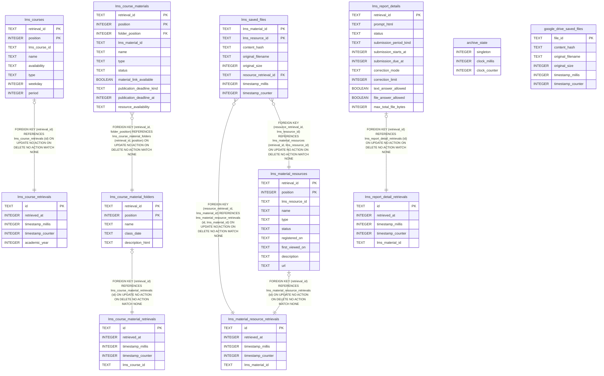

# ku-potato

## Tables

| Name | Columns | Comment | Type |
| ---- | ------- | ------- | ---- |
| [archive_state](archive_state.md) | 3 | 取得履歴と保存ファイル情報の更新順序を採番する論理時計。端末間で共有しないローカル状態 | table |
| [lms_course_retrievals](lms_course_retrievals.md) | 5 | 年度ごとの講義一覧の取得履歴。取得ごとに追記し、過去の一覧を保持する | table |
| [lms_courses](lms_courses.md) | 8 | 講義一覧のスナップショット。LMSの講義IDがない行も表示順を含めて保持する | table |
| [lms_course_material_retrievals](lms_course_material_retrievals.md) | 5 | 講義ごとの教材一覧の取得履歴。空の一覧を取得した場合も記録する | table |
| [lms_course_material_folders](lms_course_material_folders.md) | 5 | 教材一覧の取得時点における教材フォルダー。LMS上では「授業」と表示されるまとまり | table |
| [lms_course_materials](lms_course_materials.md) | 11 | 教材一覧のスナップショット。教材の種類・状態・公開期限と所属フォルダーを保持する | table |
| [lms_material_resource_retrievals](lms_material_resource_retrievals.md) | 5 | 教材ごとの資料一覧の取得履歴。未取得と、取得済みの空一覧を区別する | table |
| [lms_material_resources](lms_material_resources.md) | 10 | 資料一覧のスナップショット。ファイルや外部リンクの情報を取得時点のまま保持する | table |
| [lms_saved_files](lms_saved_files.md) | 8 | LMSのファイル資料ごとの現在の保存ファイル。成功時だけ置き換え、公開終了後も保持する | table |
| [google_drive_saved_files](google_drive_saved_files.md) | 6 | Google Driveのファイルごとの現在の保存ファイル。LMSの取得履歴とは独立して保持する | table |
| [lms_report_detail_retrievals](lms_report_detail_retrievals.md) | 5 | レポート教材ごとの詳細の取得履歴。取得ごとに追記する | table |
| [lms_report_details](lms_report_details.md) | 11 | レポート詳細のスナップショット。提出期間・修正条件・回答形式を保持する | table |

## Relations

---

> Generated by [tbls](https://github.com/k1LoW/tbls)
