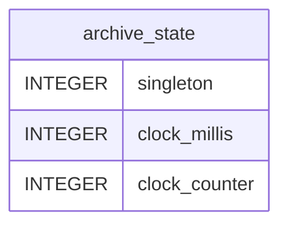

# archive_state

## Description

取得履歴と保存ファイル情報の更新順序を採番する論理時計。端末間で共有しないローカル状態

<details>
<summary><strong>Table Definition</strong></summary>

```sql
CREATE TABLE archive_state (
    -- 取得履歴と保存ファイル情報の更新順序を採番する論理時計。端末間で共有しないローカル状態
    singleton INTEGER PRIMARY KEY NOT NULL CHECK (singleton = 1), -- 常に1。DBごとに1行だけ保持する
    clock_millis INTEGER NOT NULL CHECK (clock_millis >= 0), -- 最後に採番した論理時計の時刻部分（Unixミリ秒）。実時計が戻っても減らさない
    clock_counter INTEGER NOT NULL CHECK (clock_counter >= 0) -- 論理時計の同一時刻内の連番。時刻部分を更新したら0に戻す
)
```

</details>

## Columns

| Name | Type | Default | Nullable | Children | Parents | Comment |
| ---- | ---- | ------- | -------- | -------- | ------- | ------- |
| singleton | INTEGER |  | false |  |  | 常に1。DBごとに1行だけ保持する |
| clock_millis | INTEGER |  | false |  |  | 最後に採番した論理時計の時刻部分（Unixミリ秒）。実時計が戻っても減らさない |
| clock_counter | INTEGER |  | false |  |  | 論理時計の同一時刻内の連番。時刻部分を更新したら0に戻す |

## Constraints

| Name | Type | Definition |
| ---- | ---- | ---------- |
| singleton | PRIMARY KEY | PRIMARY KEY (singleton) |
| - | CHECK | CHECK (singleton = 1) |
| - | CHECK | CHECK (clock_millis >= 0) |
| - | CHECK | CHECK (clock_counter >= 0) |

## Relations



---

> Generated by [tbls](https://github.com/k1LoW/tbls)
