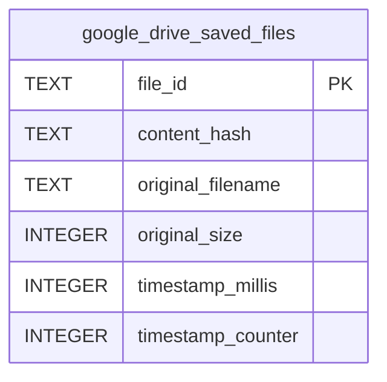

# google_drive_saved_files

## Description

Google Driveのファイルごとの現在の保存ファイル。LMSの取得履歴とは独立して保持する

<details>
<summary><strong>Table Definition</strong></summary>

```sql
CREATE TABLE google_drive_saved_files (
    -- Google Driveのファイルごとの現在の保存ファイル。LMSの取得履歴とは独立して保持する
    file_id TEXT PRIMARY KEY NOT NULL CHECK (length(file_id) BETWEEN 1 AND 256 AND file_id NOT GLOB '*[^A-Za-z0-9_-]*'), -- Google DriveのファイルID。同じファイルへの複数のリンクで保存情報を共有する
    content_hash TEXT NOT NULL, -- 原本のSHA-256
    original_filename TEXT NOT NULL, -- 保存ファイルの元のファイル名
    original_size INTEGER NOT NULL CHECK (original_size >= 0), -- 保存時の圧縮を行う前の原本サイズ（バイト）
    timestamp_millis INTEGER NOT NULL CHECK (timestamp_millis >= 0), -- 最後に保存が成功した際の論理タイムスタンプのミリ秒部分
    timestamp_counter INTEGER NOT NULL CHECK (timestamp_counter >= 0) -- 論理タイムスタンプの同一ミリ秒内の連番
)
```

</details>

## Columns

| Name | Type | Default | Nullable | Children | Parents | Comment |
| ---- | ---- | ------- | -------- | -------- | ------- | ------- |
| file_id | TEXT |  | false |  |  | Google DriveのファイルID。同じファイルへの複数のリンクで保存情報を共有する |
| content_hash | TEXT |  | false |  |  | 原本のSHA-256 |
| original_filename | TEXT |  | false |  |  | 保存ファイルの元のファイル名 |
| original_size | INTEGER |  | false |  |  | 保存時の圧縮を行う前の原本サイズ（バイト） |
| timestamp_millis | INTEGER |  | false |  |  | 最後に保存が成功した際の論理タイムスタンプのミリ秒部分 |
| timestamp_counter | INTEGER |  | false |  |  | 論理タイムスタンプの同一ミリ秒内の連番 |

## Constraints

| Name | Type | Definition |
| ---- | ---- | ---------- |
| file_id | PRIMARY KEY | PRIMARY KEY (file_id) |
| sqlite_autoindex_google_drive_saved_files_1 | PRIMARY KEY | PRIMARY KEY (file_id) |
| - | CHECK | CHECK (length(file_id) BETWEEN 1 AND 256 AND file_id NOT GLOB '*[^A-Za-z0-9_-]*') |
| - | CHECK | CHECK (original_size >= 0) |
| - | CHECK | CHECK (timestamp_millis >= 0) |
| - | CHECK | CHECK (timestamp_counter >= 0) |

## Indexes

| Name | Definition |
| ---- | ---------- |
| google_drive_saved_files_content_hash | CREATE INDEX google_drive_saved_files_content_hash ON google_drive_saved_files(content_hash) |
| sqlite_autoindex_google_drive_saved_files_1 | PRIMARY KEY (file_id) |

## Relations



---

> Generated by [tbls](https://github.com/k1LoW/tbls)
