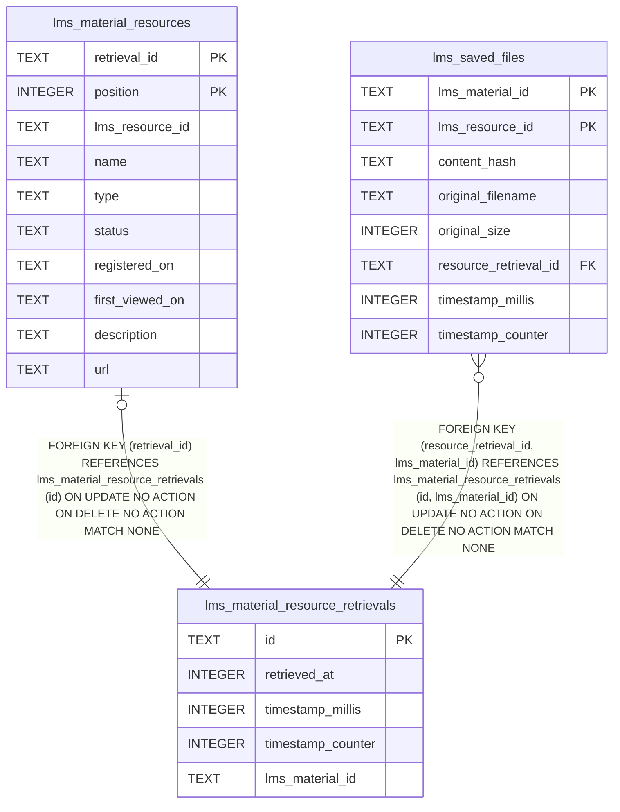

# lms_material_resource_retrievals

## Description

教材ごとの資料一覧の取得履歴。未取得と、取得済みの空一覧を区別する

<details>
<summary><strong>Table Definition</strong></summary>

```sql
CREATE TABLE lms_material_resource_retrievals (
    -- 教材ごとの資料一覧の取得履歴。未取得と、取得済みの空一覧を区別する
    id TEXT PRIMARY KEY NOT NULL, -- 種類ごとに独立した、端末間で一意な取得ID（UUID）
    retrieved_at INTEGER NOT NULL CHECK (retrieved_at >= 0), -- 取得時刻（Unixミリ秒）。表示用の日時
    timestamp_millis INTEGER NOT NULL CHECK (timestamp_millis >= retrieved_at), -- 取得順序を比較する論理タイムスタンプのミリ秒部分。取得日時とは別に保持する
    timestamp_counter INTEGER NOT NULL CHECK (timestamp_counter >= 0), -- 論理タイムスタンプの同一ミリ秒内の連番。同値の場合は取得IDで順序を決める
    lms_material_id TEXT NOT NULL, -- 取得対象のLMS教材ID
    UNIQUE (id, lms_material_id)
)
```

</details>

## Columns

| Name | Type | Default | Nullable | Children | Parents | Comment |
| ---- | ---- | ------- | -------- | -------- | ------- | ------- |
| id | TEXT |  | false | [lms_material_resources](lms_material_resources.md) [lms_saved_files](lms_saved_files.md) |  | 種類ごとに独立した、端末間で一意な取得ID（UUID） |
| retrieved_at | INTEGER |  | false |  |  | 取得時刻（Unixミリ秒）。表示用の日時 |
| timestamp_millis | INTEGER |  | false |  |  | 取得順序を比較する論理タイムスタンプのミリ秒部分。取得日時とは別に保持する |
| timestamp_counter | INTEGER |  | false |  |  | 論理タイムスタンプの同一ミリ秒内の連番。同値の場合は取得IDで順序を決める |
| lms_material_id | TEXT |  | false | [lms_saved_files](lms_saved_files.md) |  | 取得対象のLMS教材ID |

## Constraints

| Name | Type | Definition |
| ---- | ---- | ---------- |
| id | PRIMARY KEY | PRIMARY KEY (id) |
| sqlite_autoindex_lms_material_resource_retrievals_2 | UNIQUE | UNIQUE (id, lms_material_id) |
| sqlite_autoindex_lms_material_resource_retrievals_1 | PRIMARY KEY | PRIMARY KEY (id) |
| - | CHECK | CHECK (retrieved_at >= 0) |
| - | CHECK | CHECK (timestamp_millis >= retrieved_at) |
| - | CHECK | CHECK (timestamp_counter >= 0) |

## Indexes

| Name | Definition |
| ---- | ---------- |
| lms_resource_retrievals_material | CREATE INDEX lms_resource_retrievals_material ON lms_material_resource_retrievals(lms_material_id, timestamp_millis, timestamp_counter, id) |
| sqlite_autoindex_lms_material_resource_retrievals_2 | UNIQUE (id, lms_material_id) |
| sqlite_autoindex_lms_material_resource_retrievals_1 | PRIMARY KEY (id) |

## Relations



---

> Generated by [tbls](https://github.com/k1LoW/tbls)
