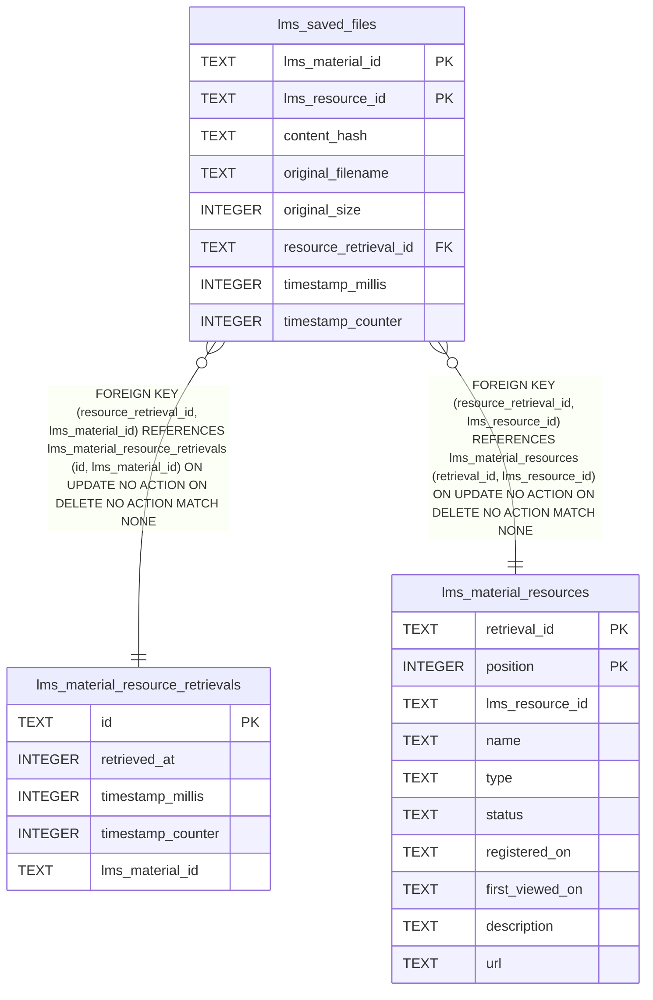

# lms_saved_files

## Description

LMSのファイル資料ごとの現在の保存ファイル。成功時だけ置き換え、公開終了後も保持する

<details>
<summary><strong>Table Definition</strong></summary>

```sql
CREATE TABLE lms_saved_files (
    -- LMSのファイル資料ごとの現在の保存ファイル。成功時だけ置き換え、公開終了後も保持する
    lms_material_id TEXT NOT NULL, -- LMSの教材ID。資料IDと組み合わせて保存ファイルを識別する
    lms_resource_id TEXT NOT NULL, -- LMSの資料ID
    content_hash TEXT NOT NULL, -- 原本のSHA-256。同じ内容を複数資料から参照できる
    original_filename TEXT NOT NULL, -- 保存ファイルの元のファイル名
    original_size INTEGER NOT NULL CHECK (original_size >= 0), -- 保存時の圧縮を行う前の原本サイズ（バイト）
    resource_retrieval_id TEXT NOT NULL, -- 保存ファイルに対応する資料一覧の取得ID。教材ID・資料IDの両方との整合性を外部キーで保証する
    timestamp_millis INTEGER NOT NULL CHECK (timestamp_millis >= 0), -- 保存ファイル情報の更新時の論理タイムスタンプのミリ秒部分。取得履歴とは独立
    timestamp_counter INTEGER NOT NULL CHECK (timestamp_counter >= 0), -- 論理タイムスタンプの同一ミリ秒内の連番
    PRIMARY KEY (lms_material_id, lms_resource_id),
    FOREIGN KEY (resource_retrieval_id, lms_resource_id) REFERENCES lms_material_resources(retrieval_id, lms_resource_id),
    FOREIGN KEY (resource_retrieval_id, lms_material_id) REFERENCES lms_material_resource_retrievals(id, lms_material_id)
)
```

</details>

## Columns

| Name | Type | Default | Nullable | Children | Parents | Comment |
| ---- | ---- | ------- | -------- | -------- | ------- | ------- |
| lms_material_id | TEXT |  | false |  | [lms_material_resource_retrievals](lms_material_resource_retrievals.md) | LMSの教材ID。資料IDと組み合わせて保存ファイルを識別する |
| lms_resource_id | TEXT |  | false |  | [lms_material_resources](lms_material_resources.md) | LMSの資料ID |
| content_hash | TEXT |  | false |  |  | 原本のSHA-256。同じ内容を複数資料から参照できる |
| original_filename | TEXT |  | false |  |  | 保存ファイルの元のファイル名 |
| original_size | INTEGER |  | false |  |  | 保存時の圧縮を行う前の原本サイズ（バイト） |
| resource_retrieval_id | TEXT |  | false |  | [lms_material_resource_retrievals](lms_material_resource_retrievals.md) [lms_material_resources](lms_material_resources.md) | 保存ファイルに対応する資料一覧の取得ID。教材ID・資料IDの両方との整合性を外部キーで保証する |
| timestamp_millis | INTEGER |  | false |  |  | 保存ファイル情報の更新時の論理タイムスタンプのミリ秒部分。取得履歴とは独立 |
| timestamp_counter | INTEGER |  | false |  |  | 論理タイムスタンプの同一ミリ秒内の連番 |

## Constraints

| Name | Type | Definition |
| ---- | ---- | ---------- |
| lms_material_id | PRIMARY KEY | PRIMARY KEY (lms_material_id) |
| lms_resource_id | PRIMARY KEY | PRIMARY KEY (lms_resource_id) |
| - (Foreign key ID: 0) | FOREIGN KEY | FOREIGN KEY (resource_retrieval_id, lms_material_id) REFERENCES lms_material_resource_retrievals (id, lms_material_id) ON UPDATE NO ACTION ON DELETE NO ACTION MATCH NONE |
| - (Foreign key ID: 1) | FOREIGN KEY | FOREIGN KEY (resource_retrieval_id, lms_resource_id) REFERENCES lms_material_resources (retrieval_id, lms_resource_id) ON UPDATE NO ACTION ON DELETE NO ACTION MATCH NONE |
| sqlite_autoindex_lms_saved_files_1 | PRIMARY KEY | PRIMARY KEY (lms_material_id, lms_resource_id) |
| - | CHECK | CHECK (original_size >= 0) |
| - | CHECK | CHECK (timestamp_millis >= 0) |
| - | CHECK | CHECK (timestamp_counter >= 0) |

## Indexes

| Name | Definition |
| ---- | ---------- |
| lms_saved_files_content_hash | CREATE INDEX lms_saved_files_content_hash ON lms_saved_files(content_hash) |
| sqlite_autoindex_lms_saved_files_1 | PRIMARY KEY (lms_material_id, lms_resource_id) |

## Relations



---

> Generated by [tbls](https://github.com/k1LoW/tbls)
