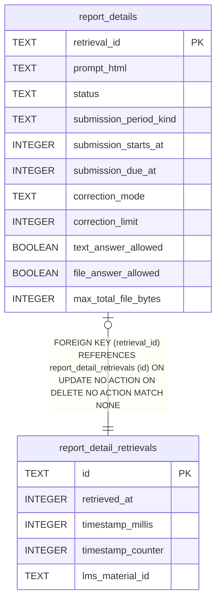

# report_details

## Description

レポート詳細のスナップショット。提出期間・修正条件・回答形式を保持する

<details>
<summary><strong>Table Definition</strong></summary>

```sql
CREATE TABLE report_details (
    -- レポート詳細のスナップショット。提出期間・修正条件・回答形式を保持する
    retrieval_id TEXT PRIMARY KEY NOT NULL REFERENCES report_detail_retrievals(id), -- レポート詳細の取得ID。1回の取得に1行が対応する
    prompt_html TEXT, -- 課題本文のHTML。取得できない場合はNULL
    status TEXT NOT NULL CHECK (status IN ('unviewed', 'unsubmitted', 'submitted', 'resubmission-required', 'evaluated', 'unknown')), -- 提出状態：unviewed、unsubmitted、submitted、resubmission-required、evaluated、unknown
    submission_period_kind TEXT NOT NULL CHECK (submission_period_kind IN ('at', 'unlisted', 'unknown')), -- 提出期間の区分：at（開始または締切あり）、unlisted（掲載なし）、unknown（不明）
    submission_starts_at INTEGER, -- 提出開始時刻（Unixミリ秒）。開始が不明・未掲載の場合はNULL
    submission_due_at INTEGER, -- 提出締切時刻（Unixミリ秒）。締切が不明・未掲載の場合はNULL
    correction_mode TEXT NOT NULL CHECK (correction_mode IN ('unknown', 'not-allowed', 'unlimited', 'limited')), -- 修正条件：unknown（不明）、not-allowed（不可）、unlimited（無制限）、limited（回数制限）
    correction_limit INTEGER CHECK (correction_limit >= 0), -- 修正回数の上限（0以上）。correction_modeがlimitedの場合のみ値を持つ
    text_answer_allowed BOOLEAN CHECK (text_answer_allowed IN (0, 1)), -- テキスト回答を許可するか（0＝不可、1＝可、NULL＝不明）
    file_answer_allowed BOOLEAN CHECK (file_answer_allowed IN (0, 1)), -- ファイル回答を許可するか（0＝不可、1＝可、NULL＝不明）
    max_total_file_bytes INTEGER CHECK (max_total_file_bytes >= 0), -- 提出ファイルの合計サイズ上限（バイト）。不明の場合はNULL
    CHECK (
        (submission_period_kind = 'at' AND (submission_starts_at IS NOT NULL OR submission_due_at IS NOT NULL))
        OR (submission_period_kind IN ('unlisted', 'unknown') AND submission_starts_at IS NULL AND submission_due_at IS NULL)
    ),
    CHECK (submission_starts_at IS NULL OR submission_due_at IS NULL OR submission_due_at >= submission_starts_at),
    CHECK ((correction_mode = 'limited') = (correction_limit IS NOT NULL))
)
```

</details>

## Columns

| Name | Type | Default | Nullable | Children | Parents | Comment |
| ---- | ---- | ------- | -------- | -------- | ------- | ------- |
| retrieval_id | TEXT |  | false |  | [report_detail_retrievals](report_detail_retrievals.md) | レポート詳細の取得ID。1回の取得に1行が対応する |
| prompt_html | TEXT |  | true |  |  | 課題本文のHTML。取得できない場合はNULL |
| status | TEXT |  | false |  |  | 提出状態：unviewed、unsubmitted、submitted、resubmission-required、evaluated、unknown |
| submission_period_kind | TEXT |  | false |  |  | 提出期間の区分：at（開始または締切あり）、unlisted（掲載なし）、unknown（不明） |
| submission_starts_at | INTEGER |  | true |  |  | 提出開始時刻（Unixミリ秒）。開始が不明・未掲載の場合はNULL |
| submission_due_at | INTEGER |  | true |  |  | 提出締切時刻（Unixミリ秒）。締切が不明・未掲載の場合はNULL |
| correction_mode | TEXT |  | false |  |  | 修正条件：unknown（不明）、not-allowed（不可）、unlimited（無制限）、limited（回数制限） |
| correction_limit | INTEGER |  | true |  |  | 修正回数の上限（0以上）。correction_modeがlimitedの場合のみ値を持つ |
| text_answer_allowed | BOOLEAN |  | true |  |  | テキスト回答を許可するか（0＝不可、1＝可、NULL＝不明） |
| file_answer_allowed | BOOLEAN |  | true |  |  | ファイル回答を許可するか（0＝不可、1＝可、NULL＝不明） |
| max_total_file_bytes | INTEGER |  | true |  |  | 提出ファイルの合計サイズ上限（バイト）。不明の場合はNULL |

## Constraints

| Name | Type | Definition |
| ---- | ---- | ---------- |
| retrieval_id | PRIMARY KEY | PRIMARY KEY (retrieval_id) |
| - (Foreign key ID: 0) | FOREIGN KEY | FOREIGN KEY (retrieval_id) REFERENCES report_detail_retrievals (id) ON UPDATE NO ACTION ON DELETE NO ACTION MATCH NONE |
| sqlite_autoindex_report_details_1 | PRIMARY KEY | PRIMARY KEY (retrieval_id) |
| - | CHECK | CHECK (status IN ('unviewed', 'unsubmitted', 'submitted', 'resubmission-required', 'evaluated', 'unknown')) |
| - | CHECK | CHECK (submission_period_kind IN ('at', 'unlisted', 'unknown')) |
| - | CHECK | CHECK (correction_mode IN ('unknown', 'not-allowed', 'unlimited', 'limited')) |
| - | CHECK | CHECK (correction_limit >= 0) |
| - | CHECK | CHECK (text_answer_allowed IN (0, 1)) |
| - | CHECK | CHECK (file_answer_allowed IN (0, 1)) |
| - | CHECK | CHECK (max_total_file_bytes >= 0) |
| - | CHECK | CHECK ( (submission_period_kind = 'at' AND (submission_starts_at IS NOT NULL OR submission_due_at IS NOT NULL)) OR (submission_period_kind IN ('unlisted', 'unknown') AND submission_starts_at IS NULL AND submission_due_at IS NULL) ) |
| - | CHECK | CHECK (submission_starts_at IS NULL OR submission_due_at IS NULL OR submission_due_at >= submission_starts_at) |
| - | CHECK | CHECK ((correction_mode = 'limited') = (correction_limit IS NOT NULL)) |

## Indexes

| Name | Definition |
| ---- | ---------- |
| sqlite_autoindex_report_details_1 | PRIMARY KEY (retrieval_id) |

## Relations



---

> Generated by [tbls](https://github.com/k1LoW/tbls)
