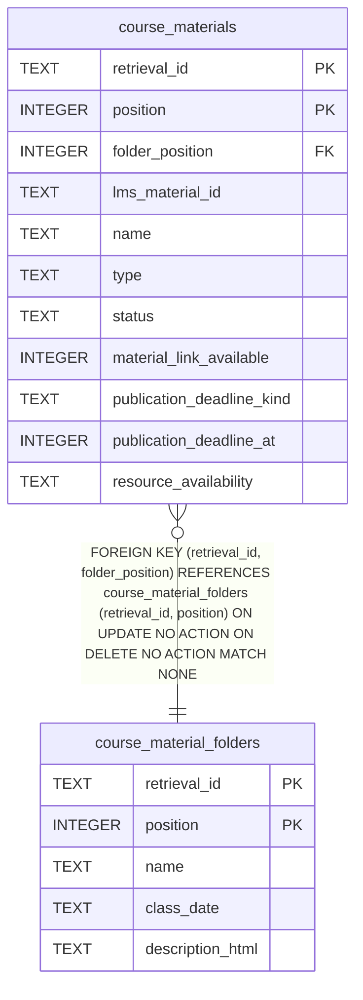

# course_materials

## Description

教材一覧のスナップショット。教材の種類・状態・公開期限と所属フォルダーを保持する

<details>
<summary><strong>Table Definition</strong></summary>

```sql
CREATE TABLE course_materials (
    -- 教材一覧のスナップショット。教材の種類・状態・公開期限と所属フォルダーを保持する
    retrieval_id TEXT NOT NULL, -- 教材一覧の取得ID
    position INTEGER NOT NULL, -- 全フォルダーを通した教材の表示順（0始まり）
    folder_position INTEGER NOT NULL, -- 同じ取得内の所属フォルダーの表示順
    lms_material_id TEXT NOT NULL, -- LMSの教材ID。同じ取得内で一意
    name TEXT NOT NULL, -- 教材名
    type TEXT NOT NULL CHECK (type IN ('material', 'report', 'test', 'questionnaire', 'e-learning', 'board', 'feedback', 'unknown')), -- 教材種別：material、report、test、questionnaire、e-learning、board、feedback、unknown
    status TEXT NOT NULL, -- 教材種別に応じた閲覧・提出・受験等の状態。不明な値はunknown。許容値はCHECK制約で定義
    material_link_available INTEGER NOT NULL CHECK (material_link_available IN (0, 1)), -- 教材へのリンクが利用可能か（0＝不可、1＝可）
    publication_deadline_kind TEXT NOT NULL CHECK (publication_deadline_kind IN ('at', 'unlisted', 'closed', 'unknown')), -- 公開期限の区分：at（日時あり）、unlisted（掲載なし）、closed（公開終了）、unknown（不明）
    publication_deadline_at INTEGER, -- 公開期限（Unixミリ秒）。区分がatの場合のみ値を持つ
    resource_availability TEXT NOT NULL, -- LMSに表示された資料の公開・利用状態
    CHECK ((publication_deadline_kind = 'at') = (publication_deadline_at IS NOT NULL)),
    CHECK (
        status = 'unknown'
        OR (type = 'material' AND status IN ('unviewed', 'viewed', 'partially-viewed'))
        OR (type = 'report' AND status IN ('unviewed', 'unsubmitted', 'submitted', 'resubmission-required', 'evaluated'))
        OR (type IN ('test', 'e-learning') AND status IN ('not-started', 'in-progress', 'completed'))
        OR (type = 'questionnaire' AND status IN ('unanswered', 'answered'))
        OR (type = 'board' AND status IN ('unposted', 'evaluated'))
        OR (type = 'feedback' AND status IN ('unevaluated', 'evaluated'))
    ),
    PRIMARY KEY (retrieval_id, position),
    UNIQUE (retrieval_id, lms_material_id),
    FOREIGN KEY (retrieval_id, folder_position) REFERENCES course_material_folders(retrieval_id, position)
)
```

</details>

## Columns

| Name | Type | Default | Nullable | Children | Parents | Comment |
| ---- | ---- | ------- | -------- | -------- | ------- | ------- |
| retrieval_id | TEXT |  | false |  | [course_material_folders](course_material_folders.md) | 教材一覧の取得ID |
| position | INTEGER |  | false |  |  | 全フォルダーを通した教材の表示順（0始まり） |
| folder_position | INTEGER |  | false |  | [course_material_folders](course_material_folders.md) | 同じ取得内の所属フォルダーの表示順 |
| lms_material_id | TEXT |  | false |  |  | LMSの教材ID。同じ取得内で一意 |
| name | TEXT |  | false |  |  | 教材名 |
| type | TEXT |  | false |  |  | 教材種別：material、report、test、questionnaire、e-learning、board、feedback、unknown |
| status | TEXT |  | false |  |  | 教材種別に応じた閲覧・提出・受験等の状態。不明な値はunknown。許容値はCHECK制約で定義 |
| material_link_available | INTEGER |  | false |  |  | 教材へのリンクが利用可能か（0＝不可、1＝可） |
| publication_deadline_kind | TEXT |  | false |  |  | 公開期限の区分：at（日時あり）、unlisted（掲載なし）、closed（公開終了）、unknown（不明） |
| publication_deadline_at | INTEGER |  | true |  |  | 公開期限（Unixミリ秒）。区分がatの場合のみ値を持つ |
| resource_availability | TEXT |  | false |  |  | LMSに表示された資料の公開・利用状態 |

## Constraints

| Name | Type | Definition |
| ---- | ---- | ---------- |
| retrieval_id | PRIMARY KEY | PRIMARY KEY (retrieval_id) |
| position | PRIMARY KEY | PRIMARY KEY (position) |
| - (Foreign key ID: 0) | FOREIGN KEY | FOREIGN KEY (retrieval_id, folder_position) REFERENCES course_material_folders (retrieval_id, position) ON UPDATE NO ACTION ON DELETE NO ACTION MATCH NONE |
| sqlite_autoindex_course_materials_2 | UNIQUE | UNIQUE (retrieval_id, lms_material_id) |
| sqlite_autoindex_course_materials_1 | PRIMARY KEY | PRIMARY KEY (retrieval_id, position) |
| - | CHECK | CHECK (type IN ('material', 'report', 'test', 'questionnaire', 'e-learning', 'board', 'feedback', 'unknown')) |
| - | CHECK | CHECK (material_link_available IN (0, 1)) |
| - | CHECK | CHECK (publication_deadline_kind IN ('at', 'unlisted', 'closed', 'unknown')) |
| - | CHECK | CHECK ((publication_deadline_kind = 'at') = (publication_deadline_at IS NOT NULL)) |
| - | CHECK | CHECK ( status = 'unknown' OR (type = 'material' AND status IN ('unviewed', 'viewed', 'partially-viewed')) OR (type = 'report' AND status IN ('unviewed', 'unsubmitted', 'submitted', 'resubmission-required', 'evaluated')) OR (type IN ('test', 'e-learning') AND status IN ('not-started', 'in-progress', 'completed')) OR (type = 'questionnaire' AND status IN ('unanswered', 'answered')) OR (type = 'board' AND status IN ('unposted', 'evaluated')) OR (type = 'feedback' AND status IN ('unevaluated', 'evaluated')) ) |

## Indexes

| Name | Definition |
| ---- | ---------- |
| materials_material_retrieval | CREATE INDEX materials_material_retrieval ON course_materials(lms_material_id, retrieval_id) |
| sqlite_autoindex_course_materials_2 | UNIQUE (retrieval_id, lms_material_id) |
| sqlite_autoindex_course_materials_1 | PRIMARY KEY (retrieval_id, position) |

## Relations



---

> Generated by [tbls](https://github.com/k1LoW/tbls)
