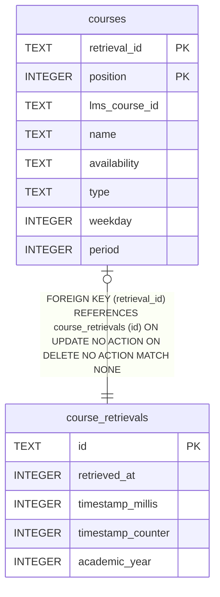

# courses

## Description

講義一覧のスナップショット。LMSの講義IDがない行も表示順を含めて保持する

<details>
<summary><strong>Table Definition</strong></summary>

```sql
CREATE TABLE courses (
    -- 講義一覧のスナップショット。LMSの講義IDがない行も表示順を含めて保持する
    retrieval_id TEXT NOT NULL REFERENCES course_retrievals(id), -- 講義一覧の取得ID
    position INTEGER NOT NULL, -- 取得した一覧内の表示順（0始まり）
    lms_course_id TEXT, -- LMSの講義ID。IDが取得できない行はNULL
    name TEXT NOT NULL, -- 講義名
    availability TEXT NOT NULL, -- LMSに表示された講義の公開・利用状態
    type TEXT NOT NULL CHECK (type IN ('scheduled', 'other', 'unknown')), -- 時間割区分：scheduled（曜日・時限あり）、other（その他）、unknown（不明）
    weekday INTEGER CHECK (weekday BETWEEN 1 AND 7), -- 曜日（1＝月曜〜7＝日曜）。scheduled以外はNULL
    period INTEGER CHECK (period >= 1), -- 時限（1始まり）。scheduled以外はNULL
    CHECK (
        (type = 'scheduled' AND weekday IS NOT NULL AND period IS NOT NULL)
        OR (type IN ('other', 'unknown') AND weekday IS NULL AND period IS NULL)
    ),
    PRIMARY KEY (retrieval_id, position)
)
```

</details>

## Columns

| Name | Type | Default | Nullable | Children | Parents | Comment |
| ---- | ---- | ------- | -------- | -------- | ------- | ------- |
| retrieval_id | TEXT |  | false |  | [course_retrievals](course_retrievals.md) | 講義一覧の取得ID |
| position | INTEGER |  | false |  |  | 取得した一覧内の表示順（0始まり） |
| lms_course_id | TEXT |  | true |  |  | LMSの講義ID。IDが取得できない行はNULL |
| name | TEXT |  | false |  |  | 講義名 |
| availability | TEXT |  | false |  |  | LMSに表示された講義の公開・利用状態 |
| type | TEXT |  | false |  |  | 時間割区分：scheduled（曜日・時限あり）、other（その他）、unknown（不明） |
| weekday | INTEGER |  | true |  |  | 曜日（1＝月曜〜7＝日曜）。scheduled以外はNULL |
| period | INTEGER |  | true |  |  | 時限（1始まり）。scheduled以外はNULL |

## Constraints

| Name | Type | Definition |
| ---- | ---- | ---------- |
| retrieval_id | PRIMARY KEY | PRIMARY KEY (retrieval_id) |
| position | PRIMARY KEY | PRIMARY KEY (position) |
| - (Foreign key ID: 0) | FOREIGN KEY | FOREIGN KEY (retrieval_id) REFERENCES course_retrievals (id) ON UPDATE NO ACTION ON DELETE NO ACTION MATCH NONE |
| sqlite_autoindex_courses_1 | PRIMARY KEY | PRIMARY KEY (retrieval_id, position) |
| - | CHECK | CHECK (type IN ('scheduled', 'other', 'unknown')) |
| - | CHECK | CHECK (weekday BETWEEN 1 AND 7) |
| - | CHECK | CHECK (period >= 1) |
| - | CHECK | CHECK ( (type = 'scheduled' AND weekday IS NOT NULL AND period IS NOT NULL) OR (type IN ('other', 'unknown') AND weekday IS NULL AND period IS NULL) ) |

## Indexes

| Name | Definition |
| ---- | ---------- |
| courses_course_retrieval | CREATE INDEX courses_course_retrieval ON courses(lms_course_id, retrieval_id) |
| sqlite_autoindex_courses_1 | PRIMARY KEY (retrieval_id, position) |

## Relations



---

> Generated by [tbls](https://github.com/k1LoW/tbls)
