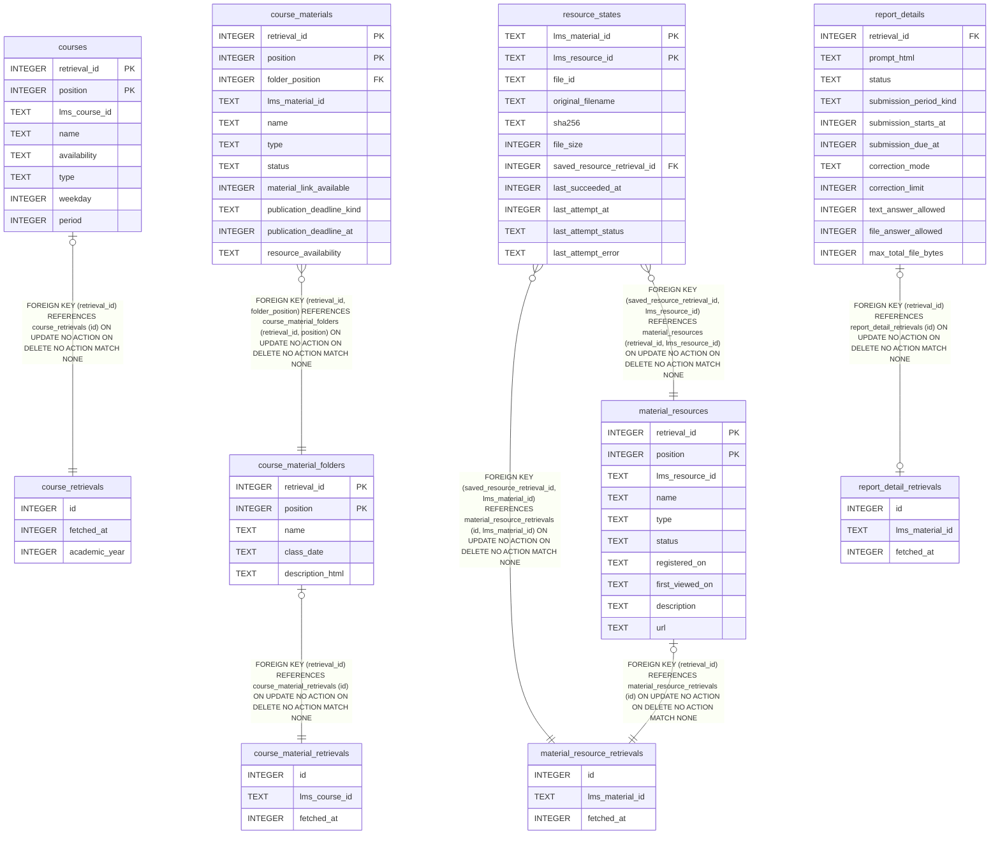

# ku-potato

## Tables

| Name | Columns | Comment | Type |
| ---- | ------- | ------- | ---- |
| [course_retrievals](course_retrievals.md) | 3 | 年度ごとの講義一覧の取得履歴。取得ごとに追記し、過去の一覧を保持する | table |
| [courses](courses.md) | 8 | 講義一覧のスナップショット。LMSの講義IDがない行も表示順を含めて保持する | table |
| [course_material_retrievals](course_material_retrievals.md) | 3 | 講義ごとの教材一覧の取得履歴。空の一覧を取得した場合も記録する | table |
| [course_material_folders](course_material_folders.md) | 5 | 教材一覧の取得時点における教材フォルダー。LMS上では「授業」と表示されるまとまり | table |
| [course_materials](course_materials.md) | 11 | 教材一覧のスナップショット。教材の種類・状態・公開期限と所属フォルダーを保持する | table |
| [material_resource_retrievals](material_resource_retrievals.md) | 3 | 教材ごとの資料一覧の取得履歴。未取得と、取得済みの空一覧を区別する | table |
| [material_resources](material_resources.md) | 10 | 資料一覧のスナップショット。ファイルや外部リンクの情報を取得時点のまま保持する | table |
| [resource_states](resource_states.md) | 11 | 教材・資料ごとの最新の取得試行とローカル保存状態。失敗時も直前に保存したファイル情報は保持する | table |
| [report_detail_retrievals](report_detail_retrievals.md) | 3 | レポート教材ごとの詳細の取得履歴。取得ごとに追記する | table |
| [report_details](report_details.md) | 11 | レポート詳細のスナップショット。提出期間・修正条件・回答形式を保持する | table |

## Relations

---

> Generated by [tbls](https://github.com/k1LoW/tbls)
