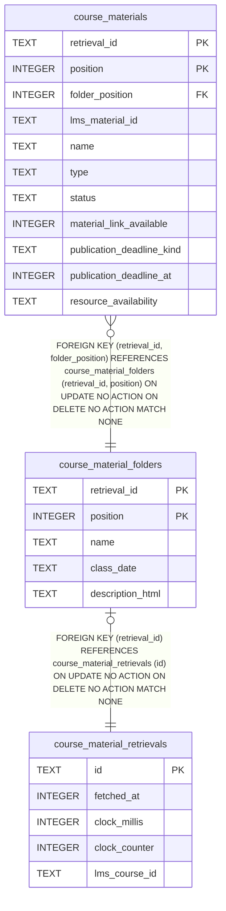

# course_material_folders

## Description

教材一覧の取得時点における教材フォルダー。LMS上では「授業」と表示されるまとまり

<details>
<summary><strong>Table Definition</strong></summary>

```sql
CREATE TABLE course_material_folders (
    -- 教材一覧の取得時点における教材フォルダー。LMS上では「授業」と表示されるまとまり
    retrieval_id TEXT NOT NULL REFERENCES course_material_retrievals(id), -- 教材一覧の取得ID
    position INTEGER NOT NULL, -- 取得した一覧内のフォルダー表示順（0始まり）
    name TEXT NOT NULL, -- 教材フォルダー名
    class_date TEXT, -- 授業日（YYYY-MM-DD）。未掲載・不正な日付はNULL
    description_html TEXT, -- フォルダーの説明HTML。取得できない場合はNULL
    PRIMARY KEY (retrieval_id, position)
)
```

</details>

## Columns

| Name | Type | Default | Nullable | Children | Parents | Comment |
| ---- | ---- | ------- | -------- | -------- | ------- | ------- |
| retrieval_id | TEXT |  | false | [course_materials](course_materials.md) | [course_material_retrievals](course_material_retrievals.md) | 教材一覧の取得ID |
| position | INTEGER |  | false | [course_materials](course_materials.md) |  | 取得した一覧内のフォルダー表示順（0始まり） |
| name | TEXT |  | false |  |  | 教材フォルダー名 |
| class_date | TEXT |  | true |  |  | 授業日（YYYY-MM-DD）。未掲載・不正な日付はNULL |
| description_html | TEXT |  | true |  |  | フォルダーの説明HTML。取得できない場合はNULL |

## Constraints

| Name | Type | Definition |
| ---- | ---- | ---------- |
| retrieval_id | PRIMARY KEY | PRIMARY KEY (retrieval_id) |
| position | PRIMARY KEY | PRIMARY KEY (position) |
| - (Foreign key ID: 0) | FOREIGN KEY | FOREIGN KEY (retrieval_id) REFERENCES course_material_retrievals (id) ON UPDATE NO ACTION ON DELETE NO ACTION MATCH NONE |
| sqlite_autoindex_course_material_folders_1 | PRIMARY KEY | PRIMARY KEY (retrieval_id, position) |

## Indexes

| Name | Definition |
| ---- | ---------- |
| sqlite_autoindex_course_material_folders_1 | PRIMARY KEY (retrieval_id, position) |

## Relations



---

> Generated by [tbls](https://github.com/k1LoW/tbls)
