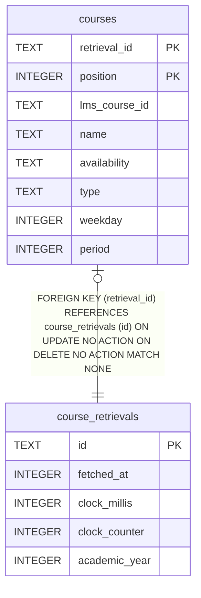

# course_retrievals

## Description

年度ごとの講義一覧の取得履歴。取得ごとに追記し、過去の一覧を保持する

<details>
<summary><strong>Table Definition</strong></summary>

```sql
CREATE TABLE course_retrievals (
    -- 年度ごとの講義一覧の取得履歴。取得ごとに追記し、過去の一覧を保持する
    id TEXT PRIMARY KEY NOT NULL, -- 種類ごとに独立した、端末間で一意な取得ID（UUID）
    fetched_at INTEGER NOT NULL CHECK (fetched_at >= 0), -- 取得時刻（Unixミリ秒）。表示用の日時
    clock_millis INTEGER NOT NULL CHECK (clock_millis >= fetched_at), -- 論理時計の時刻部分（Unixミリ秒）。取得日時とは別に順序を決める
    clock_counter INTEGER NOT NULL CHECK (clock_counter >= 0), -- 論理時計の同一時刻内の連番。同値の場合は取得IDで順序を決める
    academic_year INTEGER NOT NULL CHECK (academic_year BETWEEN 1 AND 9999) -- 対象の学年度（1〜9999）
)
```

</details>

## Columns

| Name | Type | Default | Nullable | Children | Parents | Comment |
| ---- | ---- | ------- | -------- | -------- | ------- | ------- |
| id | TEXT |  | false | [courses](courses.md) |  | 種類ごとに独立した、端末間で一意な取得ID（UUID） |
| fetched_at | INTEGER |  | false |  |  | 取得時刻（Unixミリ秒）。表示用の日時 |
| clock_millis | INTEGER |  | false |  |  | 論理時計の時刻部分（Unixミリ秒）。取得日時とは別に順序を決める |
| clock_counter | INTEGER |  | false |  |  | 論理時計の同一時刻内の連番。同値の場合は取得IDで順序を決める |
| academic_year | INTEGER |  | false |  |  | 対象の学年度（1〜9999） |

## Constraints

| Name | Type | Definition |
| ---- | ---- | ---------- |
| id | PRIMARY KEY | PRIMARY KEY (id) |
| sqlite_autoindex_course_retrievals_1 | PRIMARY KEY | PRIMARY KEY (id) |
| - | CHECK | CHECK (fetched_at >= 0) |
| - | CHECK | CHECK (clock_millis >= fetched_at) |
| - | CHECK | CHECK (clock_counter >= 0) |
| - | CHECK | CHECK (academic_year BETWEEN 1 AND 9999) |

## Indexes

| Name | Definition |
| ---- | ---------- |
| course_retrievals_year | CREATE INDEX course_retrievals_year ON course_retrievals(academic_year, clock_millis, clock_counter, id) |
| sqlite_autoindex_course_retrievals_1 | PRIMARY KEY (id) |

## Relations



---

> Generated by [tbls](https://github.com/k1LoW/tbls)
