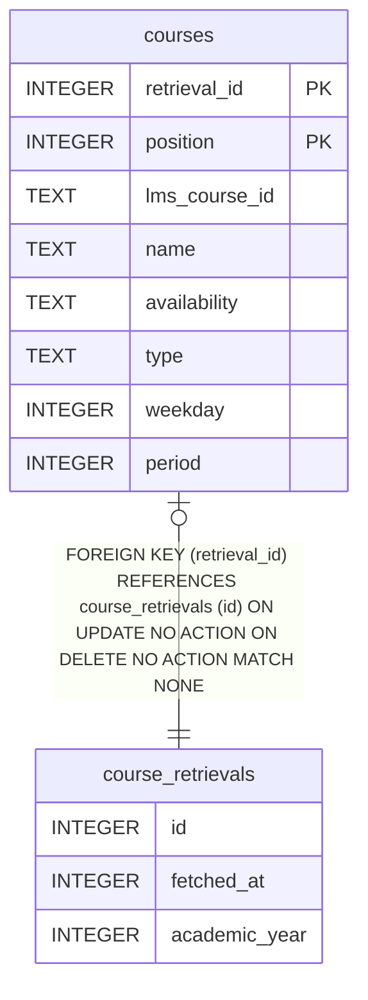

# course_retrievals

## Description

年度ごとの講義一覧の取得履歴。取得ごとに追記し、過去の一覧を保持する

<details>
<summary><strong>Table Definition</strong></summary>

```sql
CREATE TABLE course_retrievals (
    -- 年度ごとの講義一覧の取得履歴。取得ごとに追記し、過去の一覧を保持する
    id INTEGER PRIMARY KEY AUTOINCREMENT, -- 取得ID。IDの降順で最新の取得を選ぶ
    fetched_at INTEGER NOT NULL, -- 取得時刻（Unixミリ秒）
    academic_year INTEGER NOT NULL CHECK (academic_year BETWEEN 1 AND 9999) -- 対象の学年度（1〜9999）
)
```

</details>

## Columns

| Name | Type | Default | Nullable | Children | Parents | Comment |
| ---- | ---- | ------- | -------- | -------- | ------- | ------- |
| id | INTEGER |  | true | [courses](courses.md) |  | 取得ID。IDの降順で最新の取得を選ぶ |
| fetched_at | INTEGER |  | false |  |  | 取得時刻（Unixミリ秒） |
| academic_year | INTEGER |  | false |  |  | 対象の学年度（1〜9999） |

## Constraints

| Name | Type | Definition |
| ---- | ---- | ---------- |
| id | PRIMARY KEY | PRIMARY KEY (id) |
| - | CHECK | CHECK (academic_year BETWEEN 1 AND 9999) |

## Indexes

| Name | Definition |
| ---- | ---------- |
| course_retrievals_year | CREATE INDEX course_retrievals_year ON course_retrievals(academic_year, id) |

## Relations



---

> Generated by [tbls](https://github.com/k1LoW/tbls)
