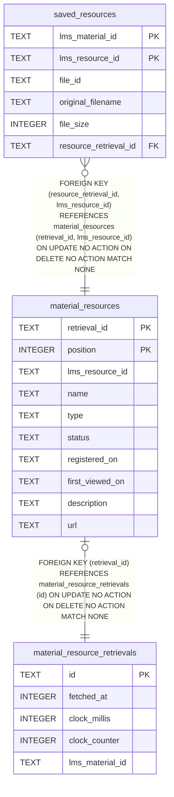

# material_resources

## Description

資料一覧のスナップショット。ファイルや外部リンクの情報を取得時点のまま保持する

<details>
<summary><strong>Table Definition</strong></summary>

```sql
CREATE TABLE material_resources (
    -- 資料一覧のスナップショット。ファイルや外部リンクの情報を取得時点のまま保持する
    retrieval_id TEXT NOT NULL REFERENCES material_resource_retrievals(id), -- 資料一覧の取得ID
    position INTEGER NOT NULL, -- 取得した一覧内の表示順（0始まり）
    lms_resource_id TEXT NOT NULL, -- LMSの資料ID。同じ取得内で一意
    name TEXT NOT NULL, -- 資料名
    type TEXT NOT NULL CHECK (type IN ('file', 'external', 'unknown')), -- 資料種別：file（ファイル）、external（外部リンク）、unknown（不明）
    status TEXT NOT NULL CHECK (status IN ('unviewed', 'viewed', 'unknown')), -- 閲覧状態：unviewed（未閲覧）、viewed（閲覧済み）、unknown（不明）
    registered_on TEXT, -- 登録日（YYYY-MM-DD）。未掲載・不正な日付はNULL
    first_viewed_on TEXT, -- 初回閲覧日（YYYY-MM-DD）。未掲載・不正な日付はNULL
    description TEXT, -- 資料の説明。取得できない場合はNULL
    url TEXT NOT NULL, -- LMSから取得した資料のURL
    PRIMARY KEY (retrieval_id, position),
    UNIQUE (retrieval_id, lms_resource_id)
)
```

</details>

## Columns

| Name | Type | Default | Nullable | Children | Parents | Comment |
| ---- | ---- | ------- | -------- | -------- | ------- | ------- |
| retrieval_id | TEXT |  | false | [saved_resources](saved_resources.md) | [material_resource_retrievals](material_resource_retrievals.md) | 資料一覧の取得ID |
| position | INTEGER |  | false |  |  | 取得した一覧内の表示順（0始まり） |
| lms_resource_id | TEXT |  | false | [saved_resources](saved_resources.md) |  | LMSの資料ID。同じ取得内で一意 |
| name | TEXT |  | false |  |  | 資料名 |
| type | TEXT |  | false |  |  | 資料種別：file（ファイル）、external（外部リンク）、unknown（不明） |
| status | TEXT |  | false |  |  | 閲覧状態：unviewed（未閲覧）、viewed（閲覧済み）、unknown（不明） |
| registered_on | TEXT |  | true |  |  | 登録日（YYYY-MM-DD）。未掲載・不正な日付はNULL |
| first_viewed_on | TEXT |  | true |  |  | 初回閲覧日（YYYY-MM-DD）。未掲載・不正な日付はNULL |
| description | TEXT |  | true |  |  | 資料の説明。取得できない場合はNULL |
| url | TEXT |  | false |  |  | LMSから取得した資料のURL |

## Constraints

| Name | Type | Definition |
| ---- | ---- | ---------- |
| retrieval_id | PRIMARY KEY | PRIMARY KEY (retrieval_id) |
| position | PRIMARY KEY | PRIMARY KEY (position) |
| - (Foreign key ID: 0) | FOREIGN KEY | FOREIGN KEY (retrieval_id) REFERENCES material_resource_retrievals (id) ON UPDATE NO ACTION ON DELETE NO ACTION MATCH NONE |
| sqlite_autoindex_material_resources_2 | UNIQUE | UNIQUE (retrieval_id, lms_resource_id) |
| sqlite_autoindex_material_resources_1 | PRIMARY KEY | PRIMARY KEY (retrieval_id, position) |
| - | CHECK | CHECK (type IN ('file', 'external', 'unknown')) |
| - | CHECK | CHECK (status IN ('unviewed', 'viewed', 'unknown')) |

## Indexes

| Name | Definition |
| ---- | ---------- |
| resources_resource_retrieval | CREATE INDEX resources_resource_retrieval ON material_resources(lms_resource_id, retrieval_id) |
| sqlite_autoindex_material_resources_2 | UNIQUE (retrieval_id, lms_resource_id) |
| sqlite_autoindex_material_resources_1 | PRIMARY KEY (retrieval_id, position) |

## Relations



---

> Generated by [tbls](https://github.com/k1LoW/tbls)
