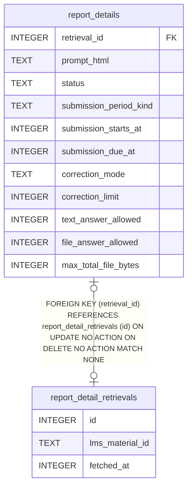

# report_detail_retrievals

## Description

レポート教材ごとの詳細の取得履歴。取得ごとに追記する

<details>
<summary><strong>Table Definition</strong></summary>

```sql
CREATE TABLE report_detail_retrievals (
    -- レポート教材ごとの詳細の取得履歴。取得ごとに追記する
    id INTEGER PRIMARY KEY AUTOINCREMENT, -- 取得ID。IDの降順で最新の取得を選ぶ
    lms_material_id TEXT NOT NULL, -- 取得対象のLMS教材ID
    fetched_at INTEGER NOT NULL -- 取得時刻（Unixミリ秒）
)
```

</details>

## Columns

| Name | Type | Default | Nullable | Children | Parents | Comment |
| ---- | ---- | ------- | -------- | -------- | ------- | ------- |
| id | INTEGER |  | true | [report_details](report_details.md) |  | 取得ID。IDの降順で最新の取得を選ぶ |
| lms_material_id | TEXT |  | false |  |  | 取得対象のLMS教材ID |
| fetched_at | INTEGER |  | false |  |  | 取得時刻（Unixミリ秒） |

## Constraints

| Name | Type | Definition |
| ---- | ---- | ---------- |
| id | PRIMARY KEY | PRIMARY KEY (id) |

## Indexes

| Name | Definition |
| ---- | ---------- |
| report_retrievals_material | CREATE INDEX report_retrievals_material ON report_detail_retrievals(lms_material_id, id) |

## Relations



---

> Generated by [tbls](https://github.com/k1LoW/tbls)
