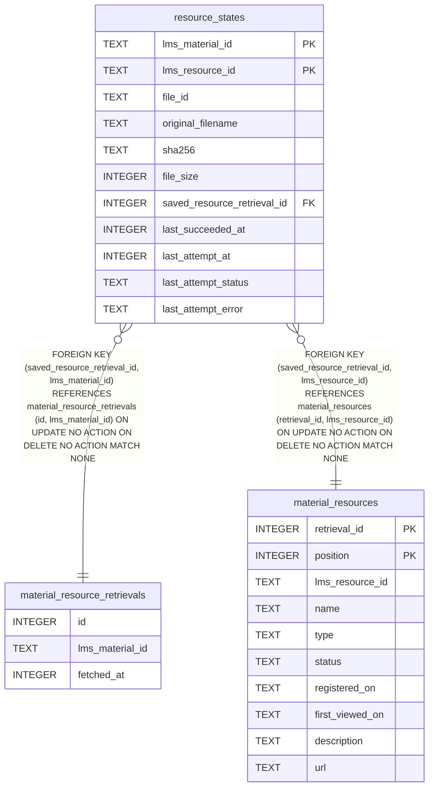

# resource_states

## Description

教材・資料ごとの最新の取得試行とローカル保存状態。失敗時も直前に保存したファイル情報は保持する

<details>
<summary><strong>Table Definition</strong></summary>

```sql
CREATE TABLE resource_states (
    -- 教材・資料ごとの最新の取得試行とローカル保存状態。失敗時も直前に保存したファイル情報は保持する
    lms_material_id TEXT NOT NULL, -- LMSの教材ID。資料IDと組み合わせて保存状態を識別する
    lms_resource_id TEXT NOT NULL, -- LMSの資料ID
    file_id TEXT, -- ローカル保存ファイルのID。保存ファイルがない場合はNULL
    original_filename TEXT, -- 保存ファイルの元のファイル名。file_idと同時に設定する
    sha256 TEXT, -- 保存ファイルのSHA-256ハッシュ。file_idと同時に設定する
    file_size INTEGER, -- 保存ファイルのサイズ（バイト）。file_idと同時に設定する
    saved_resource_retrieval_id INTEGER, -- 保存ファイルに対応する資料一覧の取得ID。教材ID・資料IDの両方との整合性を外部キーで保証する
    last_succeeded_at INTEGER, -- 最後に資料の取得が成功した時刻（Unixミリ秒）。ファイル保存を伴わない成功も含む
    last_attempt_at INTEGER, -- 最後に資料の取得を試みた時刻（Unixミリ秒）。未試行ならNULL
    last_attempt_status TEXT, -- 最後の取得結果：success（成功）、failure（失敗）。未試行ならNULL
    last_attempt_error TEXT, -- 最後の取得試行の公開用エラーメッセージ。成功時は空文字、未試行ならNULL
    PRIMARY KEY (lms_material_id, lms_resource_id),
    FOREIGN KEY (saved_resource_retrieval_id, lms_resource_id) REFERENCES material_resources(retrieval_id, lms_resource_id),
    FOREIGN KEY (saved_resource_retrieval_id, lms_material_id) REFERENCES material_resource_retrievals(id, lms_material_id),
    CHECK (
        (file_id IS NULL AND original_filename IS NULL AND sha256 IS NULL AND file_size IS NULL)
        OR (file_id IS NOT NULL AND original_filename IS NOT NULL AND sha256 IS NOT NULL AND file_size IS NOT NULL)
    ),
    CHECK ((file_id IS NOT NULL) = (saved_resource_retrieval_id IS NOT NULL)),
    CHECK ((last_attempt_at IS NULL) = (last_attempt_status IS NULL)),
    CHECK (last_attempt_status IS NULL OR last_attempt_status IN ('success', 'failure'))
)
```

</details>

## Columns

| Name | Type | Default | Nullable | Children | Parents | Comment |
| ---- | ---- | ------- | -------- | -------- | ------- | ------- |
| lms_material_id | TEXT |  | false |  | [material_resource_retrievals](material_resource_retrievals.md) | LMSの教材ID。資料IDと組み合わせて保存状態を識別する |
| lms_resource_id | TEXT |  | false |  | [material_resources](material_resources.md) | LMSの資料ID |
| file_id | TEXT |  | true |  |  | ローカル保存ファイルのID。保存ファイルがない場合はNULL |
| original_filename | TEXT |  | true |  |  | 保存ファイルの元のファイル名。file_idと同時に設定する |
| sha256 | TEXT |  | true |  |  | 保存ファイルのSHA-256ハッシュ。file_idと同時に設定する |
| file_size | INTEGER |  | true |  |  | 保存ファイルのサイズ（バイト）。file_idと同時に設定する |
| saved_resource_retrieval_id | INTEGER |  | true |  | [material_resource_retrievals](material_resource_retrievals.md) [material_resources](material_resources.md) | 保存ファイルに対応する資料一覧の取得ID。教材ID・資料IDの両方との整合性を外部キーで保証する |
| last_succeeded_at | INTEGER |  | true |  |  | 最後に資料の取得が成功した時刻（Unixミリ秒）。ファイル保存を伴わない成功も含む |
| last_attempt_at | INTEGER |  | true |  |  | 最後に資料の取得を試みた時刻（Unixミリ秒）。未試行ならNULL |
| last_attempt_status | TEXT |  | true |  |  | 最後の取得結果：success（成功）、failure（失敗）。未試行ならNULL |
| last_attempt_error | TEXT |  | true |  |  | 最後の取得試行の公開用エラーメッセージ。成功時は空文字、未試行ならNULL |

## Constraints

| Name | Type | Definition |
| ---- | ---- | ---------- |
| lms_material_id | PRIMARY KEY | PRIMARY KEY (lms_material_id) |
| lms_resource_id | PRIMARY KEY | PRIMARY KEY (lms_resource_id) |
| - (Foreign key ID: 0) | FOREIGN KEY | FOREIGN KEY (saved_resource_retrieval_id, lms_material_id) REFERENCES material_resource_retrievals (id, lms_material_id) ON UPDATE NO ACTION ON DELETE NO ACTION MATCH NONE |
| - (Foreign key ID: 1) | FOREIGN KEY | FOREIGN KEY (saved_resource_retrieval_id, lms_resource_id) REFERENCES material_resources (retrieval_id, lms_resource_id) ON UPDATE NO ACTION ON DELETE NO ACTION MATCH NONE |
| sqlite_autoindex_resource_states_1 | PRIMARY KEY | PRIMARY KEY (lms_material_id, lms_resource_id) |
| - | CHECK | CHECK ( (file_id IS NULL AND original_filename IS NULL AND sha256 IS NULL AND file_size IS NULL) OR (file_id IS NOT NULL AND original_filename IS NOT NULL AND sha256 IS NOT NULL AND file_size IS NOT NULL) ) |
| - | CHECK | CHECK ((file_id IS NOT NULL) = (saved_resource_retrieval_id IS NOT NULL)) |
| - | CHECK | CHECK ((last_attempt_at IS NULL) = (last_attempt_status IS NULL)) |
| - | CHECK | CHECK (last_attempt_status IS NULL OR last_attempt_status IN ('success', 'failure')) |

## Indexes

| Name | Definition |
| ---- | ---------- |
| sqlite_autoindex_resource_states_1 | PRIMARY KEY (lms_material_id, lms_resource_id) |

## Relations



---

> Generated by [tbls](https://github.com/k1LoW/tbls)
