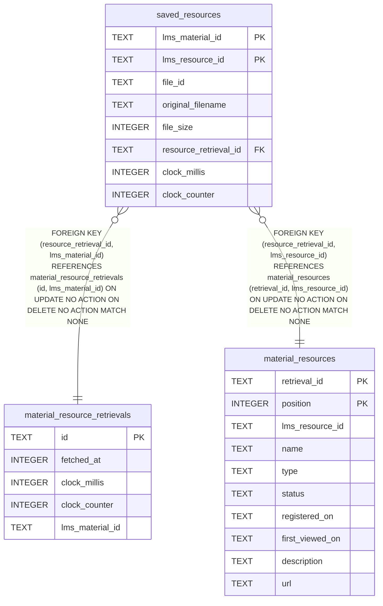

# saved_resources

## Description

教材・資料ごとの現在の保存ファイル。成功時だけ置き換え、公開終了後も保持する

<details>
<summary><strong>Table Definition</strong></summary>

```sql
CREATE TABLE saved_resources (
    -- 教材・資料ごとの現在の保存ファイル。成功時だけ置き換え、公開終了後も保持する
    lms_material_id TEXT NOT NULL, -- LMSの教材ID。資料IDと組み合わせて保存ファイルを識別する
    lms_resource_id TEXT NOT NULL, -- LMSの資料ID
    file_id TEXT NOT NULL CHECK (length(file_id) = 64 AND file_id NOT GLOB '*[^0-9a-f]*'), -- 原本のSHA-256。同じ内容を複数資料から参照できる
    original_filename TEXT NOT NULL, -- 保存ファイルの元のファイル名
    file_size INTEGER NOT NULL CHECK (file_size >= 0), -- 保存ファイルのサイズ（バイト）
    resource_retrieval_id TEXT NOT NULL, -- 保存ファイルに対応する資料一覧の取得ID。教材ID・資料IDの両方との整合性を外部キーで保証する
    clock_millis INTEGER NOT NULL CHECK (clock_millis >= 0), -- 保存ファイル情報の更新順序を決める論理時計の時刻部分（Unixミリ秒）。対応する取得履歴の時計とは独立
    clock_counter INTEGER NOT NULL CHECK (clock_counter >= 0), -- 論理時計の同一時刻内の連番。同値の場合はfile_idと残りの共有フィールドで順序を決める
    PRIMARY KEY (lms_material_id, lms_resource_id),
    FOREIGN KEY (resource_retrieval_id, lms_resource_id) REFERENCES material_resources(retrieval_id, lms_resource_id),
    FOREIGN KEY (resource_retrieval_id, lms_material_id) REFERENCES material_resource_retrievals(id, lms_material_id)
)
```

</details>

## Columns

| Name | Type | Default | Nullable | Children | Parents | Comment |
| ---- | ---- | ------- | -------- | -------- | ------- | ------- |
| lms_material_id | TEXT |  | false |  | [material_resource_retrievals](material_resource_retrievals.md) | LMSの教材ID。資料IDと組み合わせて保存ファイルを識別する |
| lms_resource_id | TEXT |  | false |  | [material_resources](material_resources.md) | LMSの資料ID |
| file_id | TEXT |  | false |  |  | 原本のSHA-256。同じ内容を複数資料から参照できる |
| original_filename | TEXT |  | false |  |  | 保存ファイルの元のファイル名 |
| file_size | INTEGER |  | false |  |  | 保存ファイルのサイズ（バイト） |
| resource_retrieval_id | TEXT |  | false |  | [material_resource_retrievals](material_resource_retrievals.md) [material_resources](material_resources.md) | 保存ファイルに対応する資料一覧の取得ID。教材ID・資料IDの両方との整合性を外部キーで保証する |
| clock_millis | INTEGER |  | false |  |  | 保存ファイル情報の更新順序を決める論理時計の時刻部分（Unixミリ秒）。対応する取得履歴の時計とは独立 |
| clock_counter | INTEGER |  | false |  |  | 論理時計の同一時刻内の連番。同値の場合はfile_idと残りの共有フィールドで順序を決める |

## Constraints

| Name | Type | Definition |
| ---- | ---- | ---------- |
| lms_material_id | PRIMARY KEY | PRIMARY KEY (lms_material_id) |
| lms_resource_id | PRIMARY KEY | PRIMARY KEY (lms_resource_id) |
| - (Foreign key ID: 0) | FOREIGN KEY | FOREIGN KEY (resource_retrieval_id, lms_material_id) REFERENCES material_resource_retrievals (id, lms_material_id) ON UPDATE NO ACTION ON DELETE NO ACTION MATCH NONE |
| - (Foreign key ID: 1) | FOREIGN KEY | FOREIGN KEY (resource_retrieval_id, lms_resource_id) REFERENCES material_resources (retrieval_id, lms_resource_id) ON UPDATE NO ACTION ON DELETE NO ACTION MATCH NONE |
| sqlite_autoindex_saved_resources_1 | PRIMARY KEY | PRIMARY KEY (lms_material_id, lms_resource_id) |
| - | CHECK | CHECK (length(file_id) = 64 AND file_id NOT GLOB '*[^0-9a-f]*') |
| - | CHECK | CHECK (file_size >= 0) |
| - | CHECK | CHECK (clock_millis >= 0) |
| - | CHECK | CHECK (clock_counter >= 0) |

## Indexes

| Name | Definition |
| ---- | ---------- |
| saved_resources_file | CREATE INDEX saved_resources_file ON saved_resources(file_id) |
| sqlite_autoindex_saved_resources_1 | PRIMARY KEY (lms_material_id, lms_resource_id) |

## Relations



---

> Generated by [tbls](https://github.com/k1LoW/tbls)
